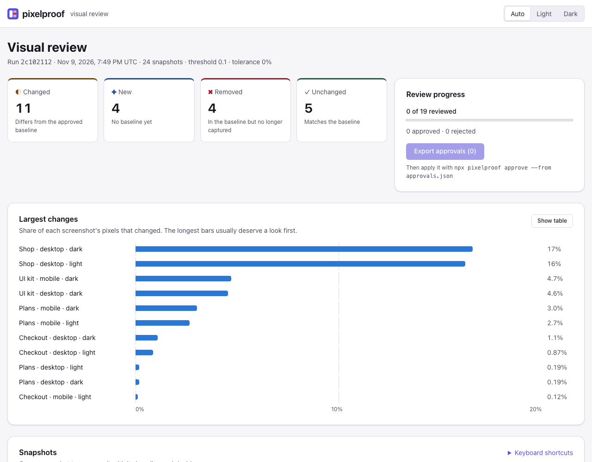
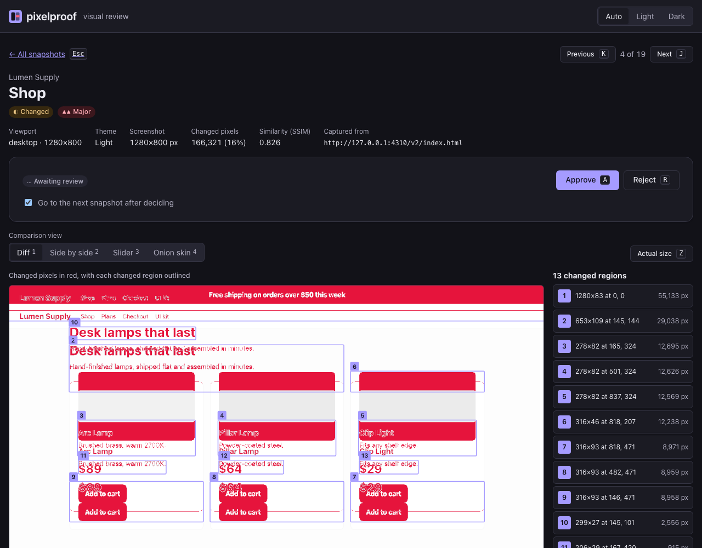
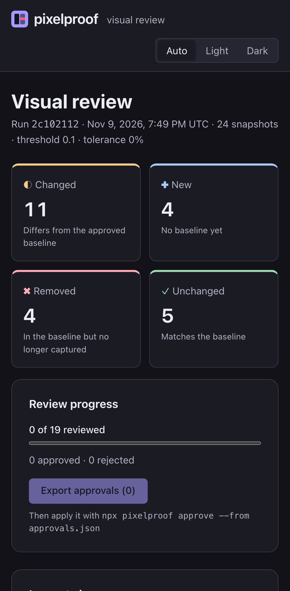
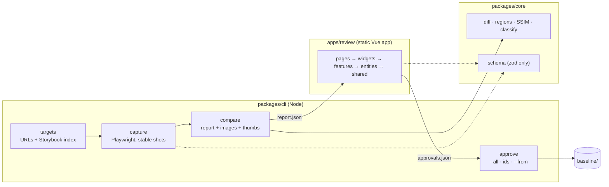
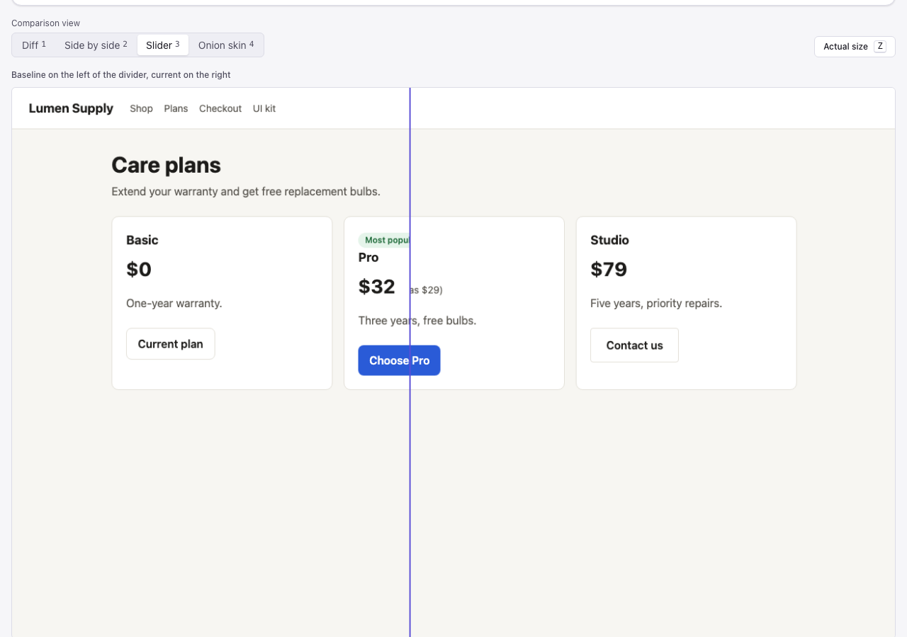

# pixelproof

**Visual regression testing for QA and frontend teams: catch unintended UI changes in CI, then review them in
seconds instead of squinting at screenshots.**

[](https://github.com/Mbarney928/pixelproof/actions/workflows/ci.yml)
[](https://mbarney928.github.io/pixelproof/)
[](LICENSE)


**Live demo:** https://mbarney928.github.io/pixelproof/ · **Storybook:** https://mbarney928.github.io/pixelproof/storybook/

The demo is a real report. CI captures 24 snapshots of an invented store, "Lumen Supply", across two
releases, then publishes the diff for you to review.



<p align="center">
  
  
</p>

## The business problem

Unit and end-to-end tests check behaviour, not appearance. A CSS refactor that shifts a price, a token change
that drops button contrast, or a dependency bump that swaps a font all pass every test and ship. Visual testing
catches these, but most setups fail in two ways:

- **Flaky diffs.** Animations, carets, late fonts and scrollbars make every run "changed". Teams raise the
  tolerance until real regressions slip through, or they switch the suite off.
- **Slow review.** A wall of 200 screenshot pairs with no ranking gets rubber-stamped.

pixelproof is for **QA engineers and frontend developers** who own UI quality. It makes capture
deterministic and ranks every change by severity. Reviewers can approve or reject from the keyboard and hand
the decisions back to CI as a file. The metrics it improves are **escaped UI regressions** and **time to
review a visual change**.

## Features

- **CLI for CI.** `pixelproof test` captures every Storybook story and/or page across viewports and light/dark
  themes, compares with the baseline, and exits `0` (pass), `1` (changes) or `2` (errors). `failOn` can be
  `any`, `major` or `never`.
- **Deterministic capture:**
  - fixed context (viewport, scale, locale, timezone, reduced motion) and pinned Chromium rendering flags
  - animations, transitions, carets and scrollbars disabled
  - waits for fonts and every image
  - keeps a screenshot only after two consecutive identical captures, and flags pages that never settle
  - masks for dynamic content
- **A diff engine that explains itself** (`@pixelproof/core`):
  - pixelmatch with anti-aliasing detection, a tinted diff image and size-change handling
  - **changed regions** clustered with union-find and numbered on the image
  - windowed **SSIM** for perceptual similarity
  - a **severity** (minor / moderate / major) from both measures
- **Review app** (Vue 3):
  - run summary and a **largest-changes chart** with a table view
  - filters stored in the URL
  - diff, side-by-side, **slider** and **onion-skin** views at fit or actual size
  - keyboard-first review (`j`/`k`, `a`/`r`/`u`, `1`–`4`, `z`, `Esc`) with auto-advance
- **Approvals round trip.** Export `approvals.json` from the review app, then
  `pixelproof approve --from approvals.json` promotes exactly those snapshots. Stale files from another run
  are refused.
- **Storybook-aware.** Reads `index.json`, filters with globs over `Title/Name`, and switches themes
  through a Storybook global.
- **Accessible and responsive.** WCAG 2.2 AA in light and dark mode, status always shown as icon plus
  text, and usable from phone to desktop.

## Architecture



**How a snapshot is judged.** Both images are padded to the same size, so a layout change always counts.
Masked areas are painted identically on both sides. pixelmatch produces a mask of differing pixels.
Clustering merges nearby pixels on a grid with union-find, giving an exact bounding box per region. SSIM is
computed on luma in 8 px windows. The verdict:

- **major:** ≥ 5% of pixels changed, SSIM < 0.90, or the page size changed
- **moderate:** ≥ 0.5% of pixels changed, or SSIM < 0.985
- **minor:** anything else above `toleranceRatio`

Key decisions are recorded as ADRs:

| ADR                                              | Decision                                                                                         |
| ------------------------------------------------ | ------------------------------------------------------------------------------------------------ |
| [0001](docs/adr/0001-report-contract.md)         | One versioned zod report contract, shared through a browser-safe export, validated on both sides |
| [0002](docs/adr/0002-deterministic-capture.md)   | Remove noise at capture time instead of tolerating it in the diff                                |
| [0003](docs/adr/0003-review-app-architecture.md) | A static, hash-routed, feature-sliced Vue app; decisions leave the browser only as a file        |

## Tech stack

| Choice                                                                           | Why                                                                                             |
| -------------------------------------------------------------------------------- | ----------------------------------------------------------------------------------------------- |
| **TypeScript (strict, `exactOptionalPropertyTypes`), npm workspaces**            | One typed contract across the CLI, the engine and the UI                                        |
| **Playwright**                                                                   | Reliable headless Chromium with masks, color-scheme and reduced-motion emulation                |
| **pixelmatch + pngjs**                                                           | Small, proven per-pixel diff with anti-aliasing detection; SSIM and clustering are built on top |
| **zod**                                                                          | Validates config, reports and approvals, with readable errors                                   |
| **commander**                                                                    | A conventional CLI with typed options and help                                                  |
| **Vue 3 + Vite, Pinia, TanStack Vue Query, Vue Router (hash)**                   | Server state and client state kept apart; hosts anywhere with no rewrites                       |
| **cva + design tokens as CSS variables**                                         | Typed component variants, light and dark themes                                                 |
| **eslint-plugin-boundaries, vue, vuejs-accessibility, typescript-eslint strict** | Architecture and accessibility rules that fail CI                                               |
| **Vitest + Testing Library + axe-core, Playwright + @axe-core/playwright**       | Unit, integration, end-to-end and accessibility testing                                         |
| **Storybook 10 + a11y addon, Lighthouse CI**                                     | A component catalog for every state, plus performance budgets                                   |

## Quick start

Requires Node 22+.

```bash
git clone https://github.com/Mbarney928/pixelproof.git
cd pixelproof
npm ci
npx playwright install chromium
npm run build:site        # build, run the real demo pipeline, build the review app with its report
npm run preview -w @pixelproof/review   # http://localhost:4173
```

No secrets are needed. `.env.example` lists the optional environment overrides (`PIXELPROOF_BASE_URL`,
`PIXELPROOF_DIR`, `PIXELPROOF_CONCURRENCY`) to set in your shell or CI.

| Command                                     | What it does                                                              |
| ------------------------------------------- | ------------------------------------------------------------------------- |
| `npm run dev -w @pixelproof/review`         | Review app with hot reload (run `npm run demo` once for a report)         |
| `npm run storybook`                         | Component catalog at http://localhost:6006                                |
| `npm test` / `npm run coverage`             | Unit and integration tests (the CLI tests drive real Chromium)            |
| `npm run e2e`                               | Playwright flows and axe scans (after `build:site` and `build-storybook`) |
| `npm run visual`                            | pixelproof testing its own Storybook (serve it on port 6007)              |
| `npm run size:check` / `npm run lighthouse` | Performance budgets (after `build:site`)                                  |

## Usage

The CLI is not on npm yet. Inside this repo `npx pixelproof` runs the workspace build. From another
project, call `node <path-to-clone>/packages/cli/dist/bin.js`, or alias it as `pixelproof`.

```bash
npx pixelproof init          # writes pixelproof.config.json
npx pixelproof test          # capture + compare; exit 1 if anything changed
npx pixelproof approve --all # accept the first run as the baseline
```

```jsonc
{
  "baseUrl": "http://127.0.0.1:6006",
  "targets": {
    "storybook": {
      "url": "/",
      "include": ["Components/**"],
      "exclude": ["**/Playground"],
      "themeGlobal": "theme",
    },
    "urls": [{ "name": "Pricing", "group": "Pages", "url": "/pricing", "mask": [".live-clock"] }],
  },
  "viewports": [
    { "name": "mobile", "width": 375, "height": 812 },
    { "name": "desktop", "width": 1280, "height": 800 },
  ],
  "themes": ["light", "dark"],
  "toleranceRatio": 0,
  "failOn": "any",
}
```

A run against the demo store:

```text
› Captured snapshots  count=20 ms=4518
› Compared snapshots  total=24 changed=11 new=4 removed=4 unchanged=5 report=.pixelproof/report/report.json
! Visual changes need review  failOn=any
```

`--log-format json` gives structured logs, and `--json` prints a summary on stdout for scripts:

```json
{ "runId": "36f54c7e-…", "summary": { "total": 80, "changed": 0, "new": 0, "removed": 0, "unchanged": 80 } }
```

Open `.pixelproof/report` with the review app (`?report=` takes any relative path to a `report.json`).
Decide, export, and apply:

```bash
npx pixelproof approve --from ~/Downloads/approvals.json
```

The engine also works as a library:

```ts
import { compareSnapshot } from '@pixelproof/core';

const result = compareSnapshot(baselinePng, currentPng, { threshold: 0.1, mergeDistance: 12 });
// { status: 'changed', severity: 'major', diff: { pixels, ratio, ssim, regions: [...] }, diffPng }
```



## Testing & quality

**Unit and integration tests:** 104 tests (Vitest).

- **Engine (33):** diff, padding, masks, clustering, SSIM, severity and the schema.
- **CLI (35):** config validation and env overrides, Storybook target resolution, worker pool, the
  approvals round trip, and real Chromium captures of a local site, including a full
  `test → approve → test → change detected` loop.
- **Review app (36):** filters, the report client (including rejected locations), and the review store.
  Integration tests mount the whole app with a fake report and drive it from the keyboard, with an axe
  check on every screen.

**Coverage:** 96.5% lines · 95.3% statements · 91.9% functions · 89.6% branches. CI enforces 85/85/85/80.

**End-to-end:** 120 Playwright tests.

- The review flow on desktop Chrome and a Pixel 7 against the real demo report: filter, open, approve and
  reject by keyboard, export and parse `approvals.json`, reload persistence, theme, skip link, and no
  sideways scrolling on small screens.
- WCAG 2.2 AA axe scans of every page and view in light and dark mode.
- An axe scan of every Storybook story in both themes.

**Visual self-test.** CI runs pixelproof against its own Storybook twice: 40 stories × 2 themes, with the timed loading skeleton excluded. All 80
captures must be identical, which guards capture determinism on Linux runners.

**Lighthouse** (desktop preset, median of 3 runs):

| Performance | Accessibility | Best practices | SEO |
| ----------- | ------------- | -------------- | --- |
| 100         | 100           | 96             | 100 |

LCP 0.5 s · TBT 0 ms · CLS 0 · page weight 178 KB. CI fails on performance < 90, accessibility < 100,
best practices < 95, SEO < 90, LCP > 2.5 s, TBT > 200 ms, CLS > 0.1 or more than 250 KB.

The weight budget caught a real problem: the snapshot list was loading every full-size screenshot (753 KB).
`compare` now writes a 144×96 area-averaged preview of each page, and the list uses it.

**Bundle:** 82 KB gzip of initial JS (budget 110 KB). The snapshot page is a 4.3 KB lazy chunk.

**Static checks:** ESLint (typescript-eslint strict-type-checked, vue, vuejs-accessibility, import
boundaries) with zero warnings allowed, Prettier, and `vue-tsc`.

## Security

- **No secrets by design.** No server, accounts, telemetry or keys, and CI uses no repository secrets.
- **Synthetic data only.** The demo store and the Storybook fixture images are invented or drawn by script.
  Screenshots are generated, never committed.
- **Untrusted input is validated:**
  - config, reports and approvals with zod
  - image paths and `?report=` restricted to the app's own folder
  - a strict CSP, with `v-html` banned by lint
  - a path-traversal guard on the demo server
- **Secret scanning.**
  - gitleaks runs as a pre-commit hook and in CI over full history.
  - GitHub secret scanning and push protection are enabled.
- **Dependency audits.**
  - `npm audit` runs in CI: zero production advisories allowed, and no high or critical in dev tooling.
  - A transitive `basic-ftp` advisory is pinned to the fixed version through `overrides`.
  - Dependabot runs for npm and GitHub Actions.
- **Hardened CI.** Read-only default token, with `pages`/`id-token` write only on the deploy job. Actions
  are pinned to commit SHAs, with `persist-credentials: false`.

See [SECURITY.md](SECURITY.md) for reporting.

## Roadmap

- **Publish `@pixelproof/cli` and `@pixelproof/core` to npm** with Changesets-managed versions.
- **PR comments:** a GitHub Action that posts the summary and a link to the hosted report on each pull request.
- **Cross-browser capture** (Firefox, WebKit) with per-browser baselines.
- **Per-region ignore from the review app:** turn a reviewed region into a saved mask in one click.
- **Baseline storage adapters** (S3-compatible, Git LFS) so large suites stay out of the repository.

## License

Released under the [MIT License](LICENSE).
